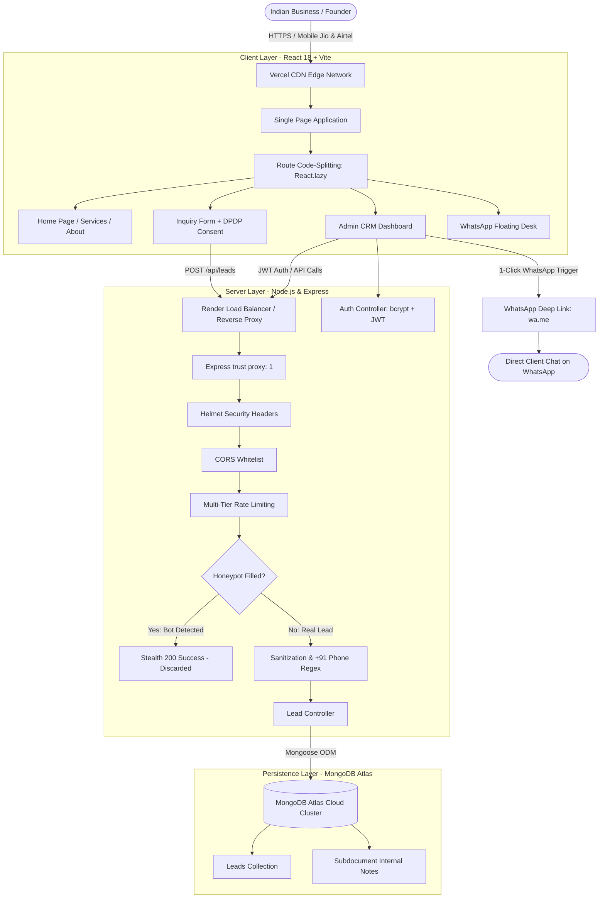
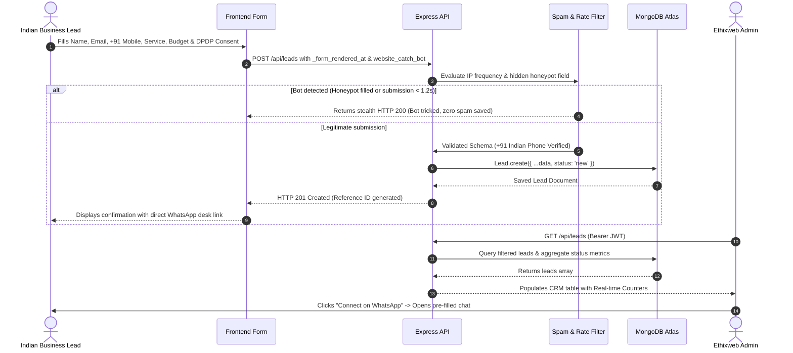
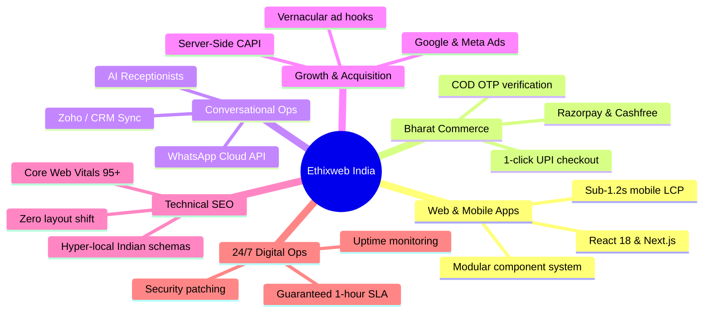
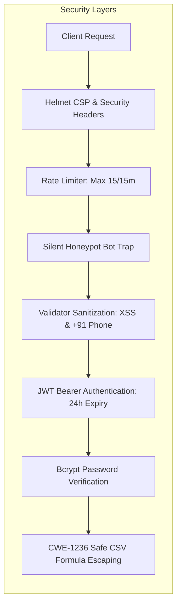

# Ethixweb India — Digital Engineering & Growth Platform

> **A high-performance digital engineering and growth agency platform engineered specifically for Indian enterprises, D2C disrupters, and high-velocity startups.**

[](https://react.dev/)
[](https://tailwindcss.com/)
[](https://nodejs.org/)
[](https://www.mongodb.com/cloud/atlas)
[](https://vercel.com/)

---

## 🌐 Live Application & Access

- **Web Application**: [https://ethixweb-india.vercel.app](https://ethixweb-india.vercel.app) *(or your deployed Vercel URL)*
- **Backend API**: [https://ethixweb-india-backend.onrender.com](https://ethixweb-india-backend.onrender.com)
- **Admin CRM Portal**: Accessible at `/admin`
  - **Demo Email**: `admin@ethixweb.com`
  - **Demo Password**: `EthixAdmin@2026`

---

## 📑 Table of Contents
1. [System Architecture Flowchart](#1-system-architecture-flowchart)
2. [Lead Intake & Anti-Spam Pipeline](#2-lead-intake--anti-spam-pipeline)
3. [Design Rationale & India Fit](#3-design-rationale--india-fit)
4. [Audit of Current Ethixweb (ethixweb.com)](#4-audit-of-current-ethixweb-ethixwebcom)
5. [Core Platform Capabilities](#5-core-platform-capabilities)
6. [Security & Data Protection](#6-security--data-protection)
7. [API Reference](#7-api-reference)
8. [Directory Structure](#8-directory-structure)
9. [Local Development & Automated Tests](#9-local-development--automated-tests)
10. [Cloud Deployment Guide](#10-cloud-deployment-guide)

---

## 1. System Architecture Flowchart

The platform follows a decoupled, cloud-native architecture optimized for speed, security, and high concurrency on Indian mobile networks:



---

## 2. Lead Intake & Anti-Spam Pipeline

How inbound inquiries are validated, protected against bots, stored in MongoDB Atlas, and routed to the sales CRM:



---

## 3. Design Rationale & India Fit

### A. The Core Strategic Vision
Ethixweb originated in the United States as a digital operations agency. While its core positioning (*"We run the tech. You run the business."*) is strong, deploying a generic US agency model in India fails to address the unique dynamics of Indian commerce.

This redesign bridges **global engineering discipline** (clean TypeScript/React codebases, modular component design, zero fragile plugins) with **Indian commercial agility and communication behaviors**.

### B. Strategic Pillars
1. **WhatsApp-First Customer Flow**:
   - Over 500 million active Indians conduct consumer and B2B business on WhatsApp. Cold email forms and Calendly links suffer high drop-off rates.
   - We integrated a dedicated WhatsApp desk in the navigation, a floating quick-action button with a live pulse indicator, and a **1-click WhatsApp trigger inside the Admin CRM** allowing operators to initiate pre-formatted WhatsApp chats with prospective clients.
2. **Indian FinTech Rails (UPI & Razorpay)**:
   - Dedicated service blueprints for 1-click UPI checkout, Razorpay, Cashfree, and Cash-on-Delivery (COD) OTP verification to combat high RTO (Return to Origin) losses in Indian D2C commerce.
3. **Legal & Regulatory Alignment**:
   - **GST-Compliant Invoicing**: Explicit assurance of standard B2B tax invoices with GSTIN for input tax credit claiming.
   - **DPDP Act (2023) Compliance**: Mandatory consent checkbox and transparent data minimization adhering to India’s Digital Personal Data Protection Act.
4. **Transparent Indicative INR (₹) Pricing**:
   - Sprint packages framed in Lakhs (₹) respecting Indian startup and MSME unit economics.
5. **Authentic Delivery Narrative**:
   - Framed as Ethixweb's specialized engineering delivery practice serving Indian clients across Bengaluru, Mumbai, and Delhi-NCR, avoiding fabricated physical infrastructure claims.

---

## 4. Audit of Current Ethixweb (ethixweb.com)

A comprehensive audit was performed on the live [ethixweb.com](http://ethixweb.com/) website to identify strengths and friction points:

| Dimension | Current US Live Site (ethixweb.com) | Ethixweb India Redesign |
| :--- | :--- | :--- |
| **Geographic Anchor** | Anchored to Wyoming LLC and *"Serving Kent, WA"*, deterring Indian enterprises | Strategic delivery coverage across Bengaluru, Mumbai & Delhi-NCR |
| **Communication Rails** | Exclusively email forms & Calendly booking | Multi-channel: **WhatsApp-First** integration, live chat link, and rapid inquiry form |
| **Payment Ecosystem** | US Stripe with standard credit cards | **UPI, Razorpay, Cashfree**, and COD OTP verification |
| **Testimonial Integrity** | Client reviews (e.g. Ryan Taylor) are duplicated 3–4 times across the DOM | Streamlined concept case studies tailored to Indian D2C and B2B sectors |
| **Pricing Transparency** | Zero budget or investment guidance | Indicative sprint price anchors in Lakhs (₹) for clear ROI expectations |
| **Mobile Performance** | Standard US broadband bundle | **Ultra-light critical bundle (<65KB gzip)** tuned for Indian 4G/5G Jio & Airtel networks |

---

## 5. Core Platform Capabilities



---

## 6. Security & Data Protection



1. **Zero Hardcoded Credentials**: Loaded strictly from environment variables (`.env` gitignored).
2. **Production Database Safety**: In `NODE_ENV === 'production'`, if `MONGODB_URI` is missing or fails, the server crashes loudly (`process.exit(1)`) to prevent silent in-memory data loss.
3. **Render Reverse Proxy Support (`trust proxy`)**: Configured with `app.set('trust proxy', 1)` in Express so that `express-rate-limit` accurately inspects client IPs behind Render's load balancer.
4. **Silent Honeypot Bot Trap**: Form contains a hidden field `website_catch_bot`. If filled, returns HTTP 200 Success and silently discards the payload without alerting the bot.
5. **CSV Formula Injection Sanitization (CWE-1236)**: Lead exports sanitize cells starting with `=`, `+`, `-`, or `@` by prepending `'` to neutralize spreadsheet code execution.

---

## 7. API Reference

| Method | Endpoint | Access | Description |
| :--- | :--- | :--- | :--- |
| `GET` | `/api/health` | Public | Server status, database connectivity & uptime |
| `POST` | `/api/leads` | Public | Submit inquiry (with honeypot & +91 phone check) |
| `POST` | `/api/auth/login` | Public | Administrator login (returns 24h JWT token) |
| `GET` | `/api/auth/verify` | Admin | Verify active JWT session token |
| `GET` | `/api/leads` | Admin | List, search & filter leads with CRM metrics |
| `GET` | `/api/leads/:id` | Admin | Retrieve single lead with full history and notes |
| `PATCH`| `/api/leads/:id/status` | Admin | Update status (`new`, `contacted`, `converted`, etc.) |
| `POST` | `/api/leads/:id/notes` | Admin | Attach dated internal follow-up note to lead |
| `GET` | `/api/leads/export/csv` | Admin | Export all leads to sanitized CSV spreadsheet |
| `DELETE`| `/api/leads/:id` | Admin | Remove lead from CRM |

---

## 8. Directory Structure

```
ethixweb-india/
├── frontend/                          # React 18 + Vite Client Application
│   ├── public/
│   │   ├── favicon.svg                # Recreated 3-bar Ethixweb emblem
│   │   └── robots.txt                 # Disallows /admin crawler indexing
│   ├── src/
│   │   ├── components/
│   │   │   ├── Navbar.jsx             # Navigation with WhatsApp CTA & mobile drawer
│   │   │   ├── Footer.jsx             # Regional coverage, GST, DPDP compliance notices
│   │   │   ├── EthixLogo.jsx          # Recreated 3-bar E brand logo component
│   │   │   ├── ContactForm.jsx        # Validated form with silent honeypot & warm-up notice
│   │   │   └── WhatsAppFloatingButton.jsx # Sticky floating WhatsApp action button
│   │   ├── pages/
│   │   │   ├── HomePage.jsx           # Value prop, capabilities, sprint framework
│   │   │   ├── ServicesPage.jsx       # 6 deep-dive offerings, tech stack, deliverables
│   │   │   ├── AboutPage.jsx          # Honest India story & engineering principles
│   │   │   ├── ContactPage.jsx        # Multi-channel contact desk & Indian business FAQ
│   │   │   └── AdminPage.jsx          # Protected CRM dashboard, status manager & notes
│   │   ├── services/api.js            # API client with health ping & timeout handling
│   │   ├── App.jsx                    # React Router with route code-splitting (React.lazy)
│   │   ├── index.css                  # Tailwind styles and custom utilities
│   │   └── main.jsx                   # Bootstrap entry
│   ├── tailwind.config.js             # Ethixweb color tokens & fonts
│   ├── vercel.json                    # Single-Page Application routing rewrite
│   ├── .env.example                   # Frontend environment template
│   └── package.json
│
├── backend/                           # Node.js + Express REST API
│   ├── src/
│   │   ├── config/db.js               # MongoDB Atlas connection (crashes loudly in prod if missing)
│   │   ├── controllers/               # authController.js, leadController.js
│   │   ├── middleware/                # auth.js, spamProtection.js, validation.js
│   │   ├── models/Lead.js             # Full Lead schema with notes, status, and metadata
│   │   ├── routes/                    # authRoutes.js, leadRoutes.js
│   │   └── utils/csvExporter.js       # Anti-formula injection safe CSV generator
│   ├── server.js                      # Express server with Helmet, trust proxy, and health checks
│   ├── render.yaml                    # Render 1-click blueprint specification
│   ├── run-tests.js                   # Automated smoke testing harness
│   ├── test-backend.js                # 10 comprehensive endpoint tests
│   ├── .env.example                   # Backend environment template
│   └── package.json
│
├── .gitignore                         # Excludes .env, node_modules, and database caches
└── README.md                          # Platform engineering documentation
```

---

## 9. Local Development & Automated Tests

### A. Install Dependencies
```bash
# 1. Install Backend
cd backend
npm install

# 2. Install Frontend
cd ../frontend
npm install
```

### B. Environment Setup
Create `backend/.env`:
```env
PORT=5000
NODE_ENV=development
FRONTEND_URL=http://localhost:5173
MONGODB_URI=mongodb+srv://<user>:<password>@cluster0.mongodb.net/ethixweb_india?retryWrites=true&w=majority
JWT_SECRET=super_secret_jwt_key_2026
ADMIN_EMAIL=admin@ethixweb.com
ADMIN_PASSWORD=EthixAdmin@2026
WHATSAPP_NUMBER=919876543210
CONTACT_EMAIL=india@ethixweb.com
```

Create `frontend/.env`:
```env
VITE_API_URL=http://localhost:5000
VITE_WHATSAPP_NUMBER=919876543210
VITE_CONTACT_EMAIL=india@ethixweb.com
```

### C. Run Locally
Terminal 1 (Backend):
```bash
cd backend
npm start
```

Terminal 2 (Frontend):
```bash
cd frontend
npm run dev
```

### D. Automated Test Suite
```bash
cd backend
node run-tests.js
```
Executes all 10 automated smoke tests:
1. Health check: `✅ PASSED`
2. Valid lead submission: `✅ PASSED`
3. Honeypot silent trap: `✅ PASSED`
4. Phone validation (`+91` rule): `✅ PASSED`
5. Admin login (JWT): `✅ PASSED`
6. Unauthenticated 401 protection: `✅ PASSED`
7. Admin fetch leads: `✅ PASSED`
8. Add internal lead note: `✅ PASSED`
9. Update status to contacted: `✅ PASSED`
10. Safe CSV export (anti-formula injection sanitized): `✅ PASSED`

---

## 10. Cloud Deployment Guide

### Step 1: MongoDB Atlas Database
1. Create a free cluster on [MongoDB Atlas](https://www.mongodb.com/cloud/atlas).
2. Under **Security → Network Access**, add `0.0.0.0/0` (Allow Access from Anywhere) so Render dynamic IPs can connect.
3. Under **Database → Connect**, copy your connection string:
   `mongodb+srv://<username>:<password>@cluster0.xxxxx.mongodb.net/ethixweb_india?retryWrites=true&w=majority`

### Step 2: Backend on Render
1. In [Render Dashboard](https://dashboard.render.com/), create a new **Web Service** from your GitHub repository.
2. Settings:
   - **Root Directory**: `backend`
   - **Build Command**: `npm install`
   - **Start Command**: `npm start`
3. Environment Variables:
   - `NODE_ENV`: `production`
   - `MONGODB_URI`: *Your MongoDB connection string*
   - `JWT_SECRET`: *A secure random string*
   - `ADMIN_EMAIL`: `admin@ethixweb.com`
   - `ADMIN_PASSWORD`: `EthixAdmin@2026`
   - `FRONTEND_URL`: *Your Vercel URL, e.g. https://ethixweb-india.vercel.app*

### Step 3: Frontend on Vercel
1. In [Vercel](https://vercel.com/), import the repository.
2. Settings:
   - **Root Directory**: `frontend`
   - **Framework Preset**: `Vite`
3. Environment Variables:
   - `VITE_API_URL`: *Your live Render URL*
   - `VITE_WHATSAPP_NUMBER`: `919876543210`
   - `VITE_CONTACT_EMAIL`: `india@ethixweb.com`
4. Click **Deploy**. Vercel deploys the application with SPA routing rules configured in `vercel.json`.

---

## 11. Admin Credentials & Access

- **Admin Portal**: `/admin`
- **Email**: `admin@ethixweb.com`
- **Password**: `EthixAdmin@2026`

---
*© Ethixweb India Platform Architecture & Digital Engineering.*
