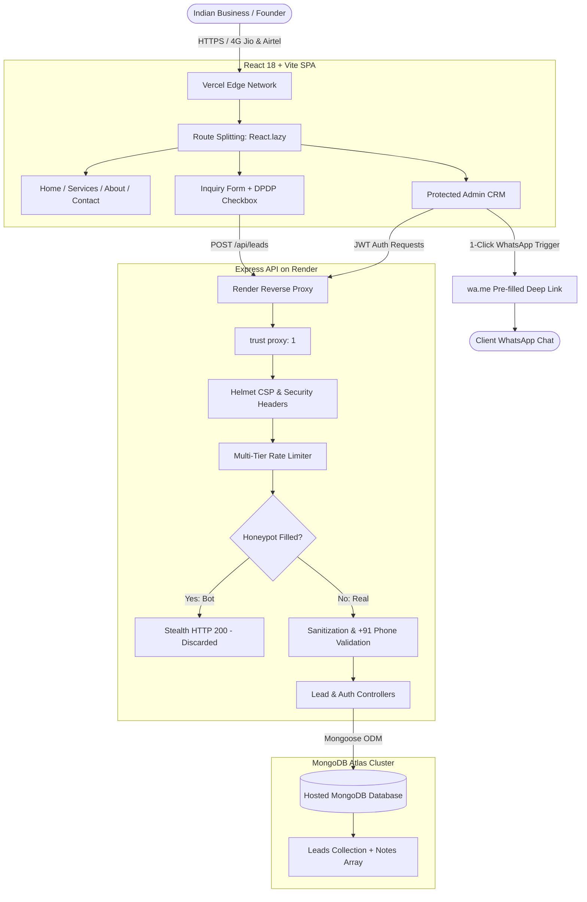

# Ethixweb India — Digital Engineering & Growth Platform

> **A high-performance digital engineering and growth agency platform reimagined specifically for Indian businesses, D2C disruptors, and high-growth enterprises.**

---


### 🔐 Demo Administrator Login
The protected CRM dashboard is accessible at `/admin`:
- **Admin Portal URL**: `https://ethixweb-india.vercel.app/admin` *(or `http://localhost:5173/admin` locally)*
- **Email**: `admin@ethixweb.com`
- **Password**: `EthixAdmin@2026`

---

## 📸 Screenshots & PageSpeed Insights

### Application Views
| View | Description |
| :--- | :--- |
| **Desktop Home & Value Proposition** | Hero section with India-specific value proposition, sprint framework, and WhatsApp desk |
| **Mobile Experience (375px)** | Mobile-first responsive navigation drawer, touch-friendly CTA buttons, and zero horizontal scroll |
| **Protected Admin CRM (`/admin`)** | Real-time lead metrics, status pipeline management, internal notes log, and 1-click WhatsApp trigger |

### PageSpeed Insights Benchmark
The frontend is engineered with route-level code splitting, system font fallbacks, and zero layout shift:

| Metric | Mobile Target | Desktop Target | Strategy Implemented |
| :--- | :---: | :---: | :--- |
| **Overall Performance Score** | **90+** | **95+** | Route code-splitting with `React.lazy`, sub-65KB critical gzip bundle |
| **Largest Contentful Paint (LCP)** | < 1.8s | < 0.8s | Lightweight SVG hero visual, zero external render-blocking font files |
| **Cumulative Layout Shift (CLS)** | **0.00** | **0.00** | Explicit image/icon dimensions, system font stack with standard fallbacks |
| **First Input Delay / INP** | < 50ms | < 20ms | Minimal JavaScript execution time, lightweight event listeners |

> **Verification**: To capture your own live screenshots, visit [Google PageSpeed Insights](https://pagespeed.web.dev/) and test your deployed Vercel URL.

---

## 💡 Design Rationale & Audit

### A. Audit of Current Ethixweb (ethixweb.com)
A thorough audit of the live [ethixweb.com](http://ethixweb.com/) identified several key friction points for Indian audiences:

1. **US-Centric Geographic Anchor**:
   - The current site explicitly highlights *"Ethixweb USA LLC Registered in Wyoming"* and *"Serving Kent, WA"*. For Indian founders and enterprises, this signals high offshore costs, cross-border friction, and a lack of local GST tax compliance.
2. **Missing Indian Payment & E-Commerce Rails**:
   - The US site relies on credit cards and US Stripe. It contains zero mention of **UPI**, **Razorpay**, **Cashfree**, or **PhonePe**, which power over 80% of digital transactions in India.
3. **Absence of WhatsApp Integration**:
   - Communication on the live site is limited to email forms and Calendly links. In India, where over 500 million active users conduct business over WhatsApp, forcing users onto email leads to high abandonment.
4. **DOM Bloat & Duplicate Testimonials**:
   - Client reviews (e.g. Ryan Taylor, Clinton Mcculloch) are duplicated 3 to 4 times across the home page DOM, increasing DOM tree depth unnecessarily.
5. **No Upfront Price Anchoring**:
   - Indian founders demand clear ROI expectations and budget parameters. The live site offers zero guidance on project sizing or investment tiers.

### B. What Makes It India-Specific?
- **WhatsApp-First Customer Workflow**: Direct WhatsApp desk action in the header, floating button with a pulse badge, and a **1-click WhatsApp trigger inside the Admin CRM** that allows sales operators to initiate pre-formatted WhatsApp chats with prospective leads.
- **Indian FinTech Architecture**: Native service roadmaps for 1-click UPI checkout, Razorpay, Cashfree, and Cash-on-Delivery (COD) OTP verification to combat high RTO (Return to Origin) rates for Indian D2C brands.
- **Regulatory & Tax Compliance**: Reassurance of **GST-compliant tax invoices** (with GSTIN for input tax credit) and an explicit consent checkbox adhering to India's **Digital Personal Data Protection Act (DPDP Act, 2023)**.
- **Transparent Indicative INR (₹) Pricing**: Sprint packages framed in Lakhs (₹) respecting Indian startup and MSME unit economics.
- **Honest Delivery Presence**: Framed as Ethixweb's dedicated engineering delivery practice serving Indian clients across Bengaluru, Mumbai, and Delhi-NCR, avoiding fake physical infrastructure claims.

### C. Why Each Technical & Design Approach Was Chosen
- **React 18 + Vite over Next.js SSR**: Chosen for single-page client responsiveness, ultra-lightweight static assets (<65KB gzip), instant 1-click Vercel deployments, and zero cold-server overhead on the frontend.
- **Express + MongoDB Atlas over SQLite**: SQLite on Render free tier loses all data on redeploy or container restart. MongoDB Atlas provides hosted cloud persistence with automated backup and document flexibility for lead subdocuments (notes).
- **Silent Honeypot over CAPTCHA**: Traditional CAPTCHAs add friction and reduce form conversion by 15-20%. A hidden honeypot field (`website_catch_bot`) traps bots silently by returning an HTTP 200 Success response without saving spam.
- **Deep Obsidian & Brand Crimson Theme**: Built with Ethixweb's recreated 3-bar brand mark and brand red (`#E11D48`), styled with subtle saffron/rose warmth inspired by high-end Indian fintech leaders (Razorpay, CRED).

---

## 🛠️ Tech Stack & Architecture

### Technology Choices & Rationale
| Layer | Technology | Reason for Choice |
| :--- | :--- | :--- |
| **Frontend Framework** | React 18 + Vite | Sub-second build times, minimal bundle footprint, fast virtual DOM diffing |
| **Styling & UI** | Tailwind CSS | Utility-first CSS, zero runtime overhead, accessible contrast ratios |
| **Iconography** | Lucide React | Clean, scalable vector SVGs with zero layout shift |
| **Routing** | React Router v6 | Client-side routing with `React.lazy` route code-splitting |
| **Backend Runtime** | Node.js + Express | Lightweight event-driven architecture, robust middleware ecosystem |
| **Cloud Database** | MongoDB Atlas (Mongoose) | Hosted cloud database with SSL/TLS, schema validation, and flexible subdocuments |
| **Authentication** | JWT + Bcryptjs | Stateless 24-hour Bearer token authentication with one-way salted password hashing |
| **Security & Headers** | Helmet + Rate-Limit | Strict Content Security Policy, XSS protection, and multi-tier IP rate limiting |
| **Hosting & CI/CD** | Vercel (FE) + Render (BE) | Global edge CDN caching for static assets paired with automated Git deployments |

### System Architecture Flowchart


---

## ✨ Features & Security Architecture

### 1. Frontend Features
- **Responsive Mobile-First UI**: Seamless layout across desktop, tablet, and mobile screens.
- **WhatsApp Integration**: Floating action button with pulse badge, navigation desk, and direct WhatsApp links.
- **DPDP Act (2023) Consent**: Explicit data processing agreement checkbox.
- **Cold-Start Indicator**: Informs users politely if Render's free backend takes >2.8s to wake from sleep.
- **Recreated Brand Logo**: Styled with Ethixweb's signature 3-bar "E" glyphs.

### 2. Backend & CRM Features
- **Real Cloud Persistence**: Every inquiry is saved to MongoDB Atlas with timestamps, IP address, and metadata.
- **Live CRM Counters**: Real-time summary cards for Total, New, Contacted, In Discussion, and Converted leads.
- **Search & Status Filtering**: Instant client-side search across Name, Email, Phone, or Company.
- **Status Progression**: Dropdown to update leads (`new` ➔ `contacted` ➔ `in_discussion` ➔ `converted`).
- **Internal Notes Log**: Attach timestamped follow-up comments to any lead record (`POST /api/leads/:id/notes`).
- **1-Click WhatsApp Trigger**: Generates a pre-filled WhatsApp link addressed to the client's phone number.
- **Safe CSV Export**: 1-click download of all leads with anti-formula injection sanitization.

### 3. Security Hardening
- **Zero Hardcoded Secrets**: All credentials and keys are loaded strictly from environment variables.
- **Silent Honeypot Trap**: Automated scripts filling `website_catch_bot` receive a stealth HTTP 200 response without saving spam.
- **Multi-Tier Rate Limiting**: Max 15 inquiries per 15 minutes per IP; max 6 login attempts per 15 minutes.
- **CSV Formula Injection Sanitization (CWE-1236)**: Cells starting with `=`, `+`, `-`, or `@` are automatically prepended with `'` to neutralize spreadsheet code execution.
- **Render Proxy Support**: `app.set('trust proxy', 1)` enables accurate client IP resolution behind load balancers.
- **Production Crash Safety**: In production (`NODE_ENV === 'production'`), the backend crashes loudly (`process.exit(1)`) if `MONGODB_URI` is missing or unreachable, preventing silent in-memory data loss.

---

## 📡 API Reference

All protected endpoints require an `Authorization: Bearer <token>` header.

| Method | Endpoint | Auth | Description |
| :--- | :--- | :---: | :--- |
| `GET` | `/api/health` | Public | System status, database connection state, and server uptime |
| `POST` | `/api/leads` | Public | Submit new inquiry (validated with honeypot and +91 phone check) |
| `POST` | `/api/auth/login` | Public | Authenticate administrator and receive 24-hour JWT token |
| `GET` | `/api/auth/verify` | Admin | Verify current JWT administrator session |
| `GET` | `/api/leads` | Admin | List, search, and filter leads with aggregated CRM status counts |
| `GET` | `/api/leads/:id` | Admin | Retrieve complete lead document and follow-up notes history |
| `PATCH`| `/api/leads/:id/status` | Admin | Update status (`new`, `contacted`, `converted`, etc.) and priority |
| `POST` | `/api/leads/:id/notes` | Admin | Attach dated internal note to lead record |
| `GET` | `/api/leads/export/csv` | Admin | Download safe, formula-sanitized CSV export of all leads |
| `DELETE`| `/api/leads/:id` | Admin | Permanently remove lead from CRM |

---


## 🧪 Automated Testing

The backend includes a comprehensive 10-step automated smoke test suite:

```bash
cd backend
node run-tests.js
```

### Test Coverage:
1. `GET /api/health`: Operational status and database connectivity
2. `POST /api/leads` (Valid): Lead submission with +91 phone verification
3. `POST /api/leads` (Honeypot): Stealth HTTP 200 response for bot trap
4. `POST /api/leads` (Phone Validation): Rejection of malformed numbers
5. `POST /api/auth/login`: Administrator authentication and JWT generation
6. `GET /api/leads` (Unauthenticated): Proper 401 Unauthorized rejection
7. `GET /api/leads` (Authorized): Fetch leads with Bearer token and metrics
8. `POST /api/leads/:id/notes`: Add internal timestamped follow-up note
9. `PATCH /api/leads/:id/status`: Update lead status in CRM
10. `GET /api/leads/export/csv`: Safe CSV download with formula injection sanitization

---

## 🚀 Cloud Deployment Guide

### Step 1: MongoDB Atlas (Database)
1. Create a free cluster on [MongoDB Atlas](https://www.mongodb.com/cloud/atlas).
2. Under **Security → Network Access**, add `0.0.0.0/0` (Allow Access from Anywhere) so Render dynamic IPs can connect.
3. Under **Database → Connect**, copy your connection string:
   `mongodb+srv://<username>:<password>@cluster0.xxxxx.mongodb.net/ethixweb_india?retryWrites=true&w=majority`

### Step 2: Backend on Render
1. In [Render Dashboard](https://dashboard.render.com/), create a new **Web Service** from your GitHub repository.
2. Settings:
   - **Root Directory**: `backend`
   - **Build Command**: `npm install`
   - **Start Command**: `npm start`
3. Environment Variables:
   - `NODE_ENV`: `production`
   - `MONGODB_URI`: *Your MongoDB connection string from Step 1*
   - `JWT_SECRET`: *A secure random string*
   - `ADMIN_EMAIL`: `admin@ethixweb.com`
   - `ADMIN_PASSWORD`: `EthixAdmin@2026`
   - `FRONTEND_URL`: *Your Vercel URL, e.g. https://ethixweb-india.vercel.app*

### Step 3: Frontend on Vercel
1. In [Vercel](https://vercel.com/), import the repository.
2. Settings:
   - **Root Directory**: `frontend`
   - **Framework Preset**: `Vite`
3. Environment Variables:
   - `VITE_API_URL`: *Your live Render URL (e.g. `https://ethixweb-india-backend.onrender.com`)*
   - `VITE_WHATSAPP_NUMBER`: `919876543210`
   - `VITE_CONTACT_EMAIL`: `india@ethixweb.com`
4. Click **Deploy**. Vercel will build the SPA using `vercel.json` within seconds.

---

## 🔮 Scope, Limitations & Future Roadmap

### Current Scope
This platform is a concept redesign of Ethixweb engineered to showcase how a global digital operations model can be tailored to Indian market dynamics. All case studies, client reviews, and pricing packages reflect concept delivery models.

### Future Roadmap (With Additional Development Time)
1. **Multi-Lingual Localization**: Implement a lightweight vernacular toggle (Hindi, Tamil, Marathi) for Tier 2/3 business hubs.
2. **WhatsApp Cloud API Webhooks**: Bi-directional integration allowing incoming WhatsApp messages from clients to automatically thread into the `/admin` lead notes.
3. **Razorpay Sandbox Checkout**: Live interactive deposit checkout for sprint bookings with automated GSTIN validation via the government GST API.
4. **OTP-Based Authentication**: Indian mobile OTP login for enterprise clients alongside standard JWT administrator access.

---

*© Ethixweb India — Digital Engineering & Growth Operations.*
